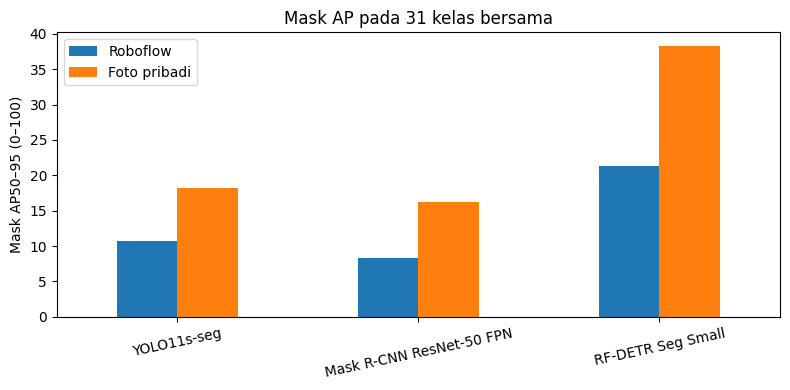
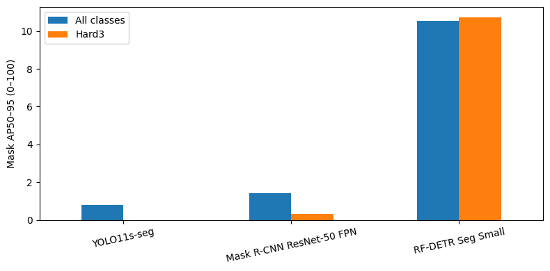
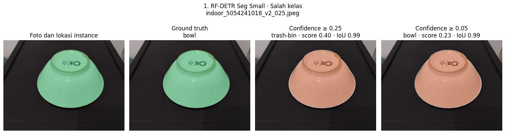
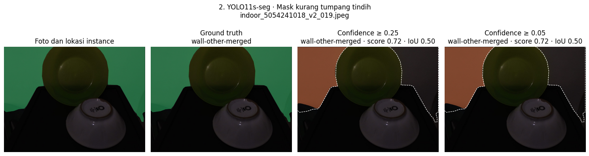
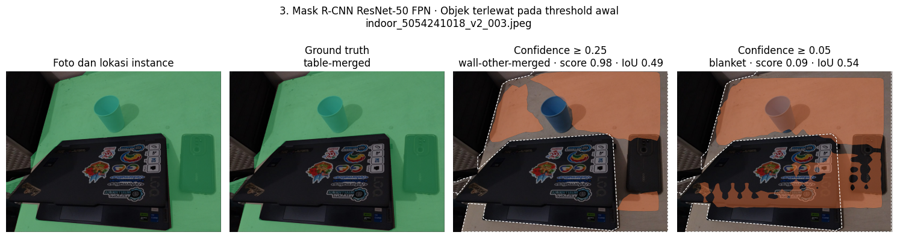
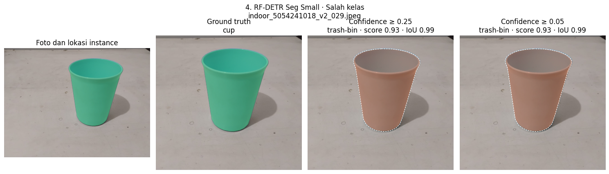
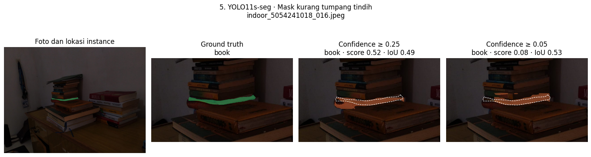

# Analisis Evaluasi CPMK 3

**Nama** Muhammad Farhan\
**NRP** 5054241018\
**Tanggal analisis** 25 November 2026

## 1. Ringkasan hasil

RF-DETR Seg Small memperoleh Mask AP tertinggi, yaitu **19,07%** pada test Roboflow dan **38,31%** pada test foto mandiri. Keunggulannya juga terlihat saat evaluasi dibatasi ke 31 kelas yang memiliki ground truth di kedua test set. Eksperimen NRP (018) menunjukkan bahwa training dengan tiga kelas tersulit menurunkan skor YOLO11s-seg dan Mask R-CNN. RF-DETR naik tipis sebesar 0,19 poin. Dalam eksperimen confidence, ambang yang lebih rendah memulihkan dua dari lima contoh, dengan tambahan false positive pada ketiga model. [Evaluasi kedua test set](04_evaluasi_foto_pribadi_colab_v2.ipynb) · [Eksperimen NRP](05_eksperimen_hard3_colab.ipynb) · [Analisis lima kasus](06_analisis_foto_pribadi_colab_v2.ipynb)

## 2. Dataset, anotasi, dan skenario evaluasi

Eksperimen memakai **Panoptic Indoor Segmentation v5** dengan **397 gambar train, 166 validation, dan 359 test**. Setelah kategori induk tanpa instance dikeluarkan dari pemetaan label, pipeline memakai 74 kelas. Terdapat 69 kelas dengan ground truth pada test Roboflow. Audit juga menemukan empat gambar train atau validation yang perlu dikoreksi orientasinya pada salinan kerja. [Panoptic Indoor Segmentation](https://universe.roboflow.com/panopticindoor/panoptic-indoor-segmentation) · [Audit dataset](results/reports/audit.json) · [Normalisasi](results/reports/normalization.json)

| Model | Keluarga arsitektur | Checkpoint evaluasi |
|---|---|---|
| YOLO11s-seg | CNN one-stage dengan segmentation head | `colab_quality01/best.pt` |
| Mask R-CNN ResNet-50 FPN | CNN two-stage, region proposal dan mask per RoI | `colab_quality02/best.pth` |
| RF-DETR Seg Small | Detection Transformer dengan segmentation head | `colab_quality01/best.pth` |

Test mandiri terdiri dari **56 foto yang diambil dengan kamera HP**, termasuk **17 foto sulit**. Nama file dan dimensi foto dicocokkan dengan COCO. Pekerjaan anotasi mencakup anotasi di Roboflow, bantuan Mask2Former dan Grounding DINO + SAM, serta pemeriksaan label oleh mahasiswa. Audit memeriksa kesesuaian label dan duplikasi mask. **COCO foto pribadi berisi 430 mask pada 56 foto, dengan ground truth untuk 31 kelas.** Label dan batas mask yang masih ambigu menjadi keterbatasan evaluasi. [Bukti proses anotasi di Roboflow](evidence/bukti-anotasi-roboflow.png) · [Validasi COCO dan metadata di Colab](04_evaluasi_foto_pribadi_colab_v2.ipynb)

Foto mandiri dipakai untuk pengujian. Hasil utama menggunakan **COCO Mask AP50–95**, yaitu AP mask pada sepuluh ambang IoU dari 0,50 hingga 0,95 yang dirata-ratakan atas kelas yang bisa dievaluasi. Mask AP50 memakai ambang IoU 0,50. [Evaluator COCO](https://github.com/cocodataset/cocoapi/blob/master/PythonAPI/pycocotools/cocoeval.py)

## 3. Performa model dan domain shift

### 3.1 Evaluasi dua test set

| Model | Mask AP Roboflow | Mask AP50 Roboflow | Mask AP foto pribadi | Mask AP50 foto pribadi |
|---|---:|---:|---:|---:|
| YOLO11s-seg | 11,05% | 17,23% | 18,20% | 25,53% |
| Mask R-CNN | 7,67% | 13,16% | 16,23% | 23,00% |
| **RF-DETR Seg Small** | **19,07%** | **27,36%** | **38,31%** | **46,41%** |

Ketiga worker berstatus `completed`. Tabel menggunakan 359 gambar Roboflow dan 56 foto mandiri. Perbandingan langsung antarsplit mencakup populasi kelas beranotasi yang berbeda, yaitu 69 kelas di Roboflow dan 31 kelas pada foto pribadi. [Tabel evaluasi](04_evaluasi_foto_pribadi_colab_v2.ipynb)

### 3.2 Perbandingan pada 31 kelas bersama

| Model | Mask AP Roboflow | Mask AP foto pribadi | Selisih foto pribadi − Roboflow |
|---|---:|---:|---:|
| YOLO11s-seg | 10,68% | 18,20% | +7,52 poin |
| Mask R-CNN | 8,32% | 16,23% | +7,92 poin |
| **RF-DETR Seg Small** | **21,37%** | **38,31%** | **+16,93 poin** |

Selisih dihitung sebelum pembulatan. Skor foto pribadi tetap lebih tinggi setelah kelas disamakan. Pada 31 kelas bersama, median luas mask ground truth relatif terhadap luas foto adalah **4,34%** pada foto pribadi dan **1,71%** pada Roboflow. Median jumlah mask beranotasi per foto adalah **5** pada foto pribadi dan **7** pada Roboflow. Luas dihitung dari jumlah piksel mask COCO yang dirasterisasi, dibagi dengan luas gambar asal.

Objek yang menempati bagian lebih besar dari foto cenderung memiliki kontur yang lebih mudah dikenali. Kesalahan beberapa piksel pada batasnya juga dapat berdampak lebih kecil pada Mask IoU. Perbedaan ukuran ini memberi penjelasan yang masuk akal untuk kenaikan AP. Jumlah mask beranotasi mencerminkan susunan objek sekaligus cakupan anotasi. Pengaruh ukuran, pencahayaan, susunan objek, dan konsistensi anotasi belum diukur secara terpisah. [Analisis domain shift](06_analisis_foto_pribadi_colab_v2.ipynb)

## 4. Eksperimen NRP 5054241018

Digit terakhir NRP adalah **8**. Tiga kelas ditetapkan dari rata-rata AP validation tiga model baseline. Kandidat masuk peringkat jika muncul dalam minimal lima gambar train dan lima gambar validation. Nilai yang rendah diprioritaskan untuk memilih kelas sulit dengan jumlah gambar yang memenuhi kriteria.

| Peringkat | Kelas | Rata-rata Mask AP validation | Gambar train | Gambar validation |
|---:|---|---:|---:|---:|
| 1 | `cabinet-merged` | 5,96% | 32 | 7 |
| 2 | `blanket` | 7,23% | 11 | 6 |
| 3 | `rug-merged` | 7,82% | 17 | 5 |

Run `hard3` mempertahankan **397 gambar train** dan hanya memakai anotasi tiga kelas terpilih sebagai target. Dari seluruh gambar train, **55 gambar** memuat target tersebut, dengan **101 instance**. Hasil dari checkpoint `all_classes` dan `hard3` dihitung pada **359 gambar test Roboflow serta tiga kelas yang identik**. Baseline dihitung dari prediksi test yang disimpan oleh run `eval_personal56`.

| Model | Mask AP `all_classes` pada tiga kelas | Mask AP `hard3` | Perubahan |
|---|---:|---:|---:|
| YOLO11s-seg | 0,79% | 0,00% | −0,79 poin |
| Mask R-CNN | 1,41% | 0,33% | −1,08 poin |
| RF-DETR Seg Small | 10,55% | 10,73% | +0,19 poin |

Spesialisasi pada tiga kelas memberi hasil yang berbeda antar-model. YOLO berhenti pada epoch 11 setelah skor validation terbaik tercatat pada epoch pertama. Mask R-CNN mencapai 30 epoch dan RF-DETR berhenti pada epoch 28. Sedikitnya contoh positif dapat membatasi manfaat spesialisasi. Selisih +0,19 poin pada RF-DETR berasal dari satu run, sehingga kestabilannya belum diukur antar-seed. [Ranking kelas, log worker, dan tabel eksperimen NRP](05_eksperimen_hard3_colab.ipynb)

## 5. Lima studi kasus kegagalan

Lima studi kasus dipilih dari prediksi pada foto pribadi. Eksperimen threshold dan evaluasi agregat mencakup seluruh 56 foto. [Notebook analisis](06_analisis_foto_pribadi_colab_v2.ipynb)

Setiap baris melaporkan ground truth, kandidat prediksi, dan Mask IoU. Hubungan dengan mekanisme model dibahas sebagai penjelasan yang sesuai dengan bukti visual. Eksperimen hanya mengubah ambang confidence, sehingga pengaruh komponen internal seperti resolusi mask belum diukur.

### 5.1 RF-DETR salah mengklasifikasikan mangkuk terbalik

**Foto `v2_025` · Ground truth `bowl`.** Pada confidence 0,25, RF-DETR memberi label `trash-bin` dengan score 0,40 dan IoU 0,994. Mask mengikuti mangkuk dengan baik. Label yang salah menunjukkan kegagalan pada skor kategori yang diasosiasikan dengan prediksi berbasis object query. Pada confidence 0,05, kandidat `bowl` dengan score 0,23 dan IoU sekitar 0,99 masuk dan cocok dengan ground truth. Hipotesis bahwa ada kandidat benar yang tertahan oleh ambang confidence didukung pada foto ini. Prediksi `trash-bin` tetap dapat dihitung sebagai false positive. [Arsitektur RF-DETR](https://arxiv.org/abs/2511.09554)

### 5.2 Mask dinding YOLO kurang menutupi sisi kanan

**Foto `v2_019` · Ground truth `wall-other-merged`.** Prediksi memiliki kelas yang sesuai dan score 0,72. Mask IoU **0,497** berada sedikit di bawah 0,50, meski panel menampilkan 0,50 setelah pembulatan. Visualisasi menunjukkan bagian sisi kanan dinding tidak tertutup oleh mask prediksi. Pada YOLO, mask instance dibentuk dari prototype mask dan koefisien per deteksi. Batas mask pada latar gelap di belakang piring merupakan bagian yang perlu diperiksa. Penurunan confidence mempertahankan kandidat yang sama dengan IoU di bawah ambang kecocokan. [Segmentation head Ultralytics](https://docs.ultralytics.com/reference/nn/modules/head/#ultralytics.nn.modules.head.Segment)

### 5.3 Mask R-CNN melewatkan kelas meja

**Foto `v2_003` · Ground truth `table-merged`.** Pada confidence 0,25, kandidat yang ditampilkan adalah `wall-other-merged` dengan score 0,98 dan IoU 0,492. Pada confidence 0,05 ada kandidat `blanket` dengan score 0,09 dan IoU sekitar 0,54. Kandidat ini melewati syarat IoU, tetapi kelasnya berbeda dari ground truth. Mask R-CNN melakukan region proposal, lalu memprediksi kelas dan mask untuk RoI. Permukaan meja yang terhalang laptop, gelas, dan ponsel dapat menyulitkan representasi region. Data keluaran memperlihatkan kekeliruan kelas pada kandidat yang tersedia, sedangkan peran tahap proposal belum dapat dipastikan. [Makalah Mask R-CNN](https://openaccess.thecvf.com/content_iccv_2017/html/He_Mask_R-CNN_ICCV_2017_paper.html)

### 5.4 RF-DETR memberi label trash-bin pada gelas

**Foto `v2_029` · Ground truth `cup`.** RF-DETR memberi label `trash-bin` dengan score 0,93 dan IoU sekitar 0,99 pada kedua confidence threshold. Mask yang hampir tepat menunjukkan bahwa model sudah menemukan lokasi dan bentuk gelas. Hasil klasifikasi menunjukkan kemungkinan kebingungan kategori pada wadah berbentuk meruncing. Ambang yang lebih rendah belum menghasilkan mask `cup` yang memenuhi syarat kecocokan pada foto ini. [Arsitektur RF-DETR](https://arxiv.org/abs/2511.09554)

### 5.5 Kandidat buku dengan mask lebih baik memiliki score lebih rendah

**Foto `016` · Ground truth `book`.** Kandidat YOLO pada confidence 0,25 menghasilkan score 0,52 dan IoU 0,492 pada satu buku di tumpukan. Saat confidence diturunkan ke 0,05, kandidat lain dengan score 0,08 mencapai IoU 0,53 dan diterima. Model menghasilkan skor kelas bersama koefisien mask dari segmentation head. Kasus ini menunjukkan bahwa urutan confidence dan kualitas overlap mask dapat berbeda pada beberapa kandidat untuk objek yang sama. [Segmentation head Ultralytics](https://docs.ultralytics.com/reference/nn/modules/head/#ultralytics.nn.modules.head.Segment)

### 5.6 Eksperimen kecil

Prediksi tersimpan dihitung ulang dengan confidence **0,25** dan **0,05**. Pada masing-masing ambang, satu prediksi dicocokkan ke maksimal satu instance ground truth dengan kelas yang sama dan IoU minimal **0,50**. Eksperimen mencakup 56 foto dan 430 mask. Hasil ini mengukur perubahan TP, FP, FN, precision, dan recall pada dua operating point. Mask AP50–95 dilaporkan terpisah.

| Model | TP awal → rendah | FP awal → rendah | FN awal → rendah | Precision | Recall |
|---|---:|---:|---:|---:|---:|
| YOLO11s-seg | 181 → 224 | 257 → 858 | 249 → 206 | 41,3% → 20,7% | 42,1% → 52,1% |
| Mask R-CNN | 104 → 145 | 417 → 1.186 | 326 → 285 | 20,0% → 10,9% | 24,2% → 33,7% |
| RF-DETR Seg Small | 270 → 333 | 472 → 3.740 | 160 → 97 | 36,4% → 8,2% | 62,8% → 77,4% |

**Dua dari lima kasus** pulih pada ambang rendah, yaitu mangkuk RF-DETR dan buku YOLO. Untuk RF-DETR, tambahan 63 true positive disertai 3.268 false positive. Temuan ini mendukung penurunan threshold sebagai cara untuk menemukan sebagian kandidat dengan score rendah, dengan biaya precision yang besar pada test set ini. Eksperimen terbatas pada mask yang sudah tersimpan dari pipeline inferensi dan batas deteksi awalnya. [Catatan kasus dan tabel threshold](06_analisis_foto_pribadi_colab_v2.ipynb)

## 6. Bukti proses, logbook, dan penggunaan AI

### 6.1 Durasi GPU

| Run | GPU | YOLO11s-seg | Mask R-CNN | RF-DETR Seg Small |
|---|---|---:|---:|---:|
| Training `all_classes` | L4 | 8 m 51 d | 34 m 34 d | 35 m 52 d |
| Training dan evaluasi `hard3` | L4 | 4 m 06 d | 20 m 36 d | 28 m 49 d |
| Evaluasi kedua test set | L4 | 2 m 58 d | 4 m 17 d | 2 m 17 d |

Durasi Mask R-CNN `all_classes` adalah jumlah waktu 30 epoch dalam log `colab_quality02`. Kolom lain menggunakan durasi worker yang dicetak notebook, termasuk persiapan dan evaluasi yang dilakukan worker. Total waktu worker `hard3` sekitar **53 m 30 d** dan evaluasi kedua test set sekitar **9 m 33 d**. Riwayat sesi meliputi kendala resume CUDA pada percobaan Mask R-CNN sebelumnya dan keputusan menjalankan ulang model itu dengan label baru. [Colab sesi 1](results/colab/colab_quality01_session1.ipynb) · [Colab sesi 2](results/colab/colab_quality01_session2.ipynb) · [Mask R-CNN quality02](results/colab/colab_quality02_maskrcnn.ipynb) · [Logbook](LOGBOOK.md)

Log training skenario semua kelas tersedia sebagai CSV untuk YOLO11s-seg (`colab_quality01`) dan Mask R-CNN (`colab_quality02`), serta berkas TensorBoard untuk RF-DETR Seg Small (`colab_quality01`). Ketiga berkas dapat dibuka melalui tautan Drive berikut. [CSV YOLO](https://drive.google.com/file/d/1IAhz5Iw1eeHmef0u75kyz18VEOrBl2cC/view?usp=drive_link) · [CSV Mask R-CNN](https://drive.google.com/file/d/1gmMSFbj-uzc-Bri4D-50K2n5qNd_wkyU/view?usp=drive_link) · [TensorBoard RF-DETR](https://drive.google.com/file/d/1BRpkx9Z3BTyCZO9CQ2NIeo-C_j4eSFZl/view?usp=drive_link) · [Riwayat commit](https://github.com/KuliahFarhan/Computer_Vision_Tugas-Evaluasi-CPMK-3-/commits)

### 6.2 Pencatatan hipotesis dan bukti foto

Hipotesis awal memperkirakan YOLO11s-seg paling efisien, Mask R-CNN menghasilkan mask yang lebih presisi daripada YOLO11s-seg, dan RF-DETR Seg Small unggul dalam akurasi segmentasi dan generalisasi. RF-DETR memperoleh Mask AP tertinggi pada kedua test set. Mask AP agregat Mask R-CNN berada di bawah YOLO11s-seg pada kedua test set, sedangkan presisi batas mask memerlukan metrik tersendiri. Durasi worker mencakup lebih dari inferensi, sehingga kecepatan inferensi memerlukan pengukuran dengan protokol yang sama. Asumsi sudah ada sebelum training pertama dan baru didokumentasikan secara retrospektif pada 25 November 2026. Rumusan yang terdokumentasi memuat dugaan pada tingkat model. [Logbook](LOGBOOK.md)

Screenshot Roboflow memperlihatkan mask dan label pada foto `indoor_5054241018_013.jpeg` di editor. Seluruh **56 foto uji**, termasuk **17 foto sulit**, memiliki padanan berkas asli yang unik. EXIF pada berkas asli mencatat kamera **Motorola moto g45 5G** dan tanggal pemotretan **24 November 2026** pada tag `DateTimeOriginal`. [Screenshot anotasi](evidence/bukti-anotasi-roboflow.png) · [Pemetaan foto dan metadata EXIF](evidence/metadata-foto-mandiri.csv)

### 6.3 Deklarasi penggunaan AI

AI dipakai untuk membantu penulisan notebook, diagnosis kesalahan, audit visual label, pemeriksaan hasil, dan penyusunan laporan. Ground truth awal juga memakai bantuan model anotasi. Koreksi label dan pemilihan contoh untuk laporan ditinjau berdasarkan foto serta output yang tersimpan.

Tiga prompt utama dari pengerjaan ini:

- “coba editkan ipynb yang tinggal saya runing di colab untuk pengujian dataset foto pribadi sya”
- “kira kira ini bakal lama ga ya training nya dan apa ya notebook nya, coba buatkan notebook salinan untuk saya jalankan experiment ini”
- “apakah saya upload dulu folder hasil anotasi dan labelnya, lalu anda revisi dan cek ulang semuanya apakah ini sudah bener apa tidak labelnya gitu bisa ga anda ??”

Salah satu kesalahan konkret terjadi pada Notebook 04 awal. Kode memperlakukan CSV metadata sebagai syarat wajib, sehingga evaluasi terhenti dengan `FileNotFoundError` meskipun foto dan COCO sudah terbaca. Perbaikannya mencatat metadata yang belum ditemukan dan melanjutkan evaluasi. Audit gambar, COCO, dan validasi file tetap berjalan. [Implementasi perbaikan](04_evaluasi_foto_pribadi_colab_v2.ipynb)

## 7. Status pengumpulan

| Ketentuan | Status | Bukti |
|---|---|---|
| Menyiapkan Panoptic Indoor Segmentation v5 | Selesai | Split 397/166/359, audit, dan normalisasi tercatat. |
| Minimal tiga model dari dua keluarga | Selesai | YOLO11s-seg, Mask R-CNN, RF-DETR Seg Small. |
| Minimal 40 foto ruangan dari HP sendiri | Selesai | 56 foto pada manifest dan COCO foto pribadi. |
| Minimal 10 foto kondisi sulit | Selesai | 17 dari 56 terverifikasi lewat metadata seleksi. |
| Anotasi sendiri di Roboflow dan kelas konsisten | Paket evaluasi tersedia | Screenshot proses tersedia. Paket COCO selaras dengan 74 ID kelas training. Metode manual dan bantuan AI dicatat. |
| Screenshot anotasi dan EXIF/metadata asli | Selesai | Screenshot tersedia. EXIF terverifikasi untuk seluruh 56 foto, termasuk 17 foto sulit. |
| Training dan log asli | Selesai | Kedua CSV dan berkas TensorBoard RF-DETR dapat dibuka melalui tautan di §6.1. |
| Evaluasi kedua test set | Selesai | Ketiga worker evaluasi selesai. |
| Analisis domain shift | Selesai | Mask AP pada 31 kelas bersama dengan penjelasan keterbatasan. |
| Memilih tiga kelas sulit dan mencatat dasarnya | Selesai | Ranking AP validation dan dukungan train/validation. |
| Membandingkan `hard3` dan `all_classes` | Selesai | Tabel dan grafik pada set test serta kelas yang sama. |
| Memilih lima foto kegagalan | Selesai | Lima panel analisis pada bagian 5. |
| Menjelaskan kegagalan berdasarkan mekanisme | Selesai di laporan | Observasi, kemungkinan mekanisme, dan batas inferensi pada §5. |
| Eksperimen kecil dan hasil | Selesai | Confidence 0,25 dibanding 0,05, pada lima kasus dan 56 foto. |
| Waktu GPU dan logbook | Selesai | Durasi tercantum pada §6.1 dan logbook mencatat eksperimen serta keputusan. |
| Hipotesis tertulis sebelum training pertama | Belum terpenuhi | Asumsi awal didokumentasikan secara retrospektif pada 25 November 2026. |
| Deklarasi AI, prompt, dan contoh perbaikan | Selesai di laporan | Tiga prompt dan contoh koreksi kode dicatat pada §6.3. |
| Demo dan tanya jawab 10 menit | Selesai | Demo telah dilaksanakan bersama dosen berdasarkan konfirmasi mahasiswa. [Notebook demo](07_inferensi_foto_baru_colab.ipynb) |
